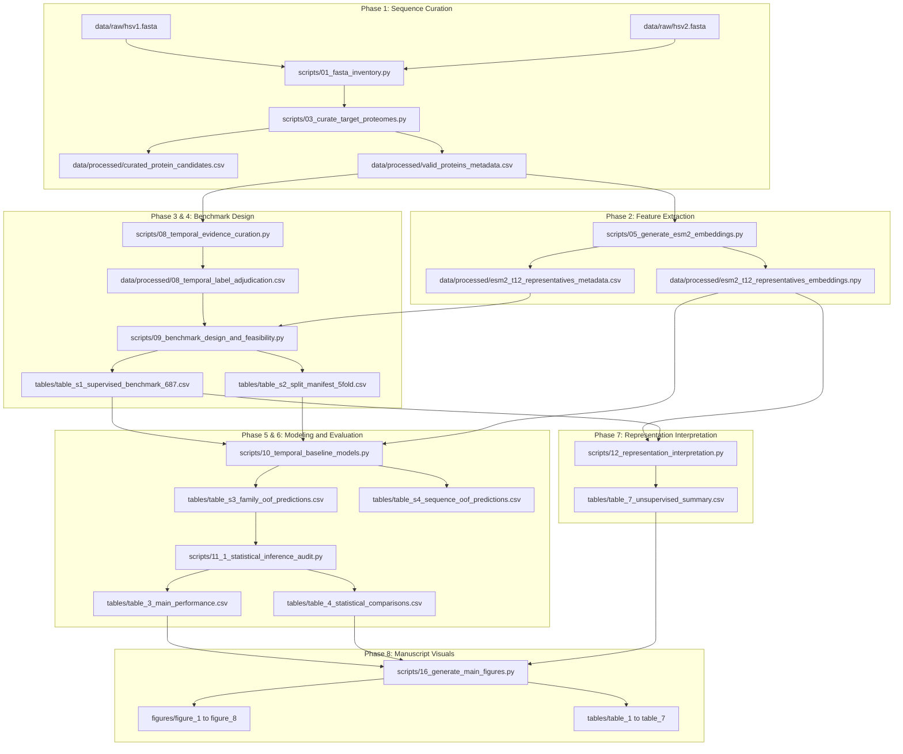

# Comprehensive Project File Guide

This document is the authoritative directory and file inventory for the `Herpes-Simplex-Virus-Analysis-02` repository. It documents every meaningful directory, script, dataset, manifest, prediction ledger, figure, table, and report in the project, detailing its purpose, inputs, outputs, reproducibility status, and position in the scientific workflow.

---

## 1. Directory Structure and Architectural Purpose

| Directory Path | Role in Repository | Retention / Distribution Policy |
|---|---|---|
| [data/raw/](file:///data/raw/) | Immutable primary viral FASTA files directly downloaded from UniProt (`hsv1.fasta`, `hsv2.fasta`). | Retained; cryptographically verified with SHA-256 manifest. |
| [data/processed/](file:///data/processed/) | Quality-filtered proteomes, ESM-2 embeddings, evidence adjudication, and split manifests. | Retained; fundamental inputs to all modeling and statistical analyses. |
| [docs/](file:///docs/) | Authoritative study documentation, reproducibility manuals, data dictionaries, decision records, and 10-phase historical scientific logs. | Retained; permanent scientific and governance documentation. |
| [docs/phases/](file:///docs/phases/) | Consolidated, step-by-step scientific documentation for Phases 01 through 10. | Retained; detailed audit trail and methodology record. |
| [docs/decisions/](file:///docs/decisions/) | Architectural Decision Records (ADRs 01 to 05) explaining rationale for pivotal design choices. | Retained; formal decision logs. |
| [scripts/](file:///scripts/) | Canonical numbered Python analytical scripts and operational helpers. | Retained; core reproducibility engine. |
| [tests/](file:///tests/) | Comprehensive test suite (160+ unit, integration, and scientific integrity tests). | Retained; automated verification infrastructure. |
| [tables/](file:///manuscript/tables//) | Publication-ready CSV and formatted tables (Tables 1 through 7, Tables S1 through S8). | Retained; mirrored in paper submission bundle. |
| [figures/](file:///figures/) | High-resolution publication figures in PDF (vector) and PNG (300 DPI) formats (Figures 1 through 8). | Retained; mirrored in paper submission bundle. |
| [reports/](file:///reports/) | Scientific audit ledgers, peer review audits, and validation logs. | Retained; complete research history. |
| [reports/validation/](file:///reports/validation/) | Cryptographic file inventories, reorganization maps, and structural validation logs. | Retained; repository governance. |
| [manuscript/](file:///manuscript/) | Curated journal submission files (manuscript text, submission figures, and submission tables). | Submission bundle; ready for journal submission. |

---

## 2. Canonical Critical Files (Sources of Truth)

| Scientific Role | Authoritative File Path | Format | Verification / Join Key |
|---|---|---|---|
| **Raw Sequence Data** | [data/raw/hsv1.fasta](file:///data/raw/hsv1.fasta) [data/raw/hsv2.fasta](file:///data/raw/hsv2.fasta) | FASTA | SHA-256 verified in [data/raw/RAW_DATA_CHECKSUMS.sha256](file:///data/raw/RAW_DATA_CHECKSUMS.sha256) |
| **Curated Proteome Candidates** | [data/processed/curated_protein_candidates.csv](file:///data/processed/curated_protein_candidates.csv) | CSV | `record_id`, `species`, `gene_symbol`, `sequence` |
| **Valid Candidates Metadata** | [data/processed/valid_proteins_metadata.csv](file:///data/processed/valid_proteins_metadata.csv) | CSV | `record_id`, `effective_species`, `effective_gene_symbol` |
| **ESM-2 Embeddings** | [data/processed/esm2_t12_representatives_embeddings.npy](file:///data/processed/esm2_t12_representatives_embeddings.npy) | NPY | Tensor of shape $(3111, 480)$ |
| **ESM-2 Metadata** | [data/processed/esm2_t12_representatives_metadata.csv](file:///data/processed/esm2_t12_representatives_metadata.csv) | CSV | `record_id`, `effective_gene_symbol`, `embedding_row_index` |
| **Temporal Evidence Adjudication** | [data/processed/08_temporal_label_adjudication.csv](file:///data/processed/08_temporal_label_adjudication.csv) | CSV | `gene_symbol`, `adjudicated_temporal_class`, `confidence_tier` |
| **Temporal Evidence Sources** | [data/processed/08_temporal_evidence_sources.csv](file:///data/processed/08_temporal_evidence_sources.csv) | CSV | `source_id`, `citation`, `doi`, `pubmed_id` |
| **Direct Temporal Benchmark** | [tables/table_s1_supervised_benchmark_687.csv](file:///manuscript/supplementary_materials/table_s1_supervised_benchmark_687.csv) | CSV | 687 sequences, 63 families, `normalized_temporal_class` |
| **Family-Disjoint Splits** | [tables/table_s2_split_manifest_5fold.csv](file:///manuscript/supplementary_materials/table_s2_split_manifest_5fold.csv) | CSV | `homology_group_id`, `fold_index` (0 to 4) |
| **Out-of-Fold Family Predictions** | [tables/table_s3_family_oof_predictions.csv](file:///manuscript/supplementary_materials/table_s3_family_oof_predictions.csv) | CSV | Out-of-fold predicted probabilities per family ($63 \times 5 = 315$ rows) |
| **Out-of-Fold Sequence Predictions** | [tables/table_s4_sequence_oof_predictions.csv](file:///manuscript/supplementary_materials/table_s4_sequence_oof_predictions.csv) | CSV | Out-of-fold predictions per sequence ($687 \times 5 = 3,435$ rows) |
| **Comparative Metrics** | [tables/table_3_main_performance.csv](file:///manuscript/tables/table_3_main_performance.csv) | CSV | Macro-F1, Balanced Acc, bootstrap 95% CIs |
| **Hypothesis Testing Ledger** | [tables/table_4_statistical_comparisons.csv](file:///manuscript/tables/table_4_statistical_comparisons.csv) | CSV | McNemar exact p-values, Holm-adjusted p-values |
| **Primary Manuscript Text** | [manuscript/main_manuscript.md](file:///manuscript/main_manuscript.md) [reports/16_illustrated_manuscript.md](file:///reports/16_illustrated_manuscript.md) | Markdown | Publication draft with embedded visual figures |

---

## 3. End-to-End Scientific Dependency Map

---

## 4. Comprehensive File Inventory

| Path | Type | Purpose | Inputs | Outputs | Required for Reproduction? | Safe to Regenerate? |
|---|---|---|---|---|---|---|
| `data/raw/hsv1.fasta` | FASTA | Reference proteome for HSV-1 strain 17 | External UniProt | Primary sequences | **Yes (Source)** | No (Immutable) |
| `data/raw/hsv2.fasta` | FASTA | Reference proteome for HSV-2 strain HG52 | External UniProt | Primary sequences | **Yes (Source)** | No (Immutable) |
| `data/raw/RAW_DATA_CHECKSUMS.sha256` | SHA-256 | Cryptographic integrity ledger for raw FASTAs | Raw FASTA files | Verified hashes | Yes | Yes |
| `data/processed/curated_protein_candidates.csv` | CSV | Curated sequence table across HSV-1 and HSV-2 | `data/raw/*.fasta` | Curated sequence records | Yes | Yes |
| `data/processed/valid_proteins_metadata.csv` | CSV | Valid candidate sequences ($\ge 70$ aa) metadata | Sequence curation | Clean metadata table | Yes | Yes |
| `data/processed/esm2_t12_representatives_embeddings.npy` | NPY | Mean-pooled 480-dim ESM-2 embedding tensor | `valid_proteins_metadata.csv` | Latent embedding matrix | Yes | Yes |
| `data/processed/esm2_t12_representatives_metadata.csv` | CSV | Alignment manifest for embedding rows | Embedding extraction | Matrix row indices | Yes | Yes |
| `data/processed/08_temporal_label_adjudication.csv` | CSV | Direct-evidence temporal classifications | Literature audit | Adjudicated timing classes | Yes | Yes |
| `data/processed/08_temporal_evidence_sources.csv` | CSV | Literature citations and PubMed accessions | PubMed literature | Source bibliographic data | Yes | Yes |
| `data/processed/08_1_strict_temporal_benchmark.csv` | CSV | Benchmark candidate sequences ($N=3,111$) | Sequences + Labels | Candidate benchmark dataset | Yes | Yes |
| `data/processed/09_group_split_manifest.csv` | CSV | 5-fold cross-validation partition map | Benchmark dataset | Fold assignments (0-4) | Yes | Yes |
| `tables/table_s1_supervised_benchmark_687.csv` | CSV | Master 687-sequence, 63-family benchmark | Benchmark candidate data | Direct-evidence benchmark | Yes | Yes |
| `tables/table_s2_split_manifest_5fold.csv` | CSV | Strict 5-fold cross-validation partition map | Benchmark dataset | Partition assignments | Yes | Yes |
| `tables/table_s3_family_oof_predictions.csv` | CSV | Out-of-fold family predictions across 5 models | Model training | Family predictions ($N=315$) | Yes | Yes |
| `tables/table_s4_sequence_oof_predictions.csv` | CSV | Out-of-fold sequence predictions across 5 models | Model training | Sequence predictions ($N=3,435$)| Yes | Yes |
| `tables/table_1_dataset_accounting.csv` | CSV | Summary of curated proteomes (length, cohorts) | Sequence curation | Publication Table 1 | Yes | Yes |
| `tables/table_2_model_configurations.csv` | CSV | Model architectures and hyperparameters | Modeling configuration | Publication Table 2 | Yes | Yes |
| `tables/table_3_main_performance.csv` | CSV | Performance comparison (Macro-F1, Balanced Acc, CIs) | `11_1_statistical_inference_audit.py` | Publication Table 3 | Yes | Yes |
| `tables/table_4_statistical_comparisons.csv` | CSV | Statistical tests (McNemar, Holm-adjusted p-values) | `11_1_statistical_inference_audit.py` | Publication Table 4 | Yes | Yes |
| `tables/table_5_temporal_evidence_summary.csv` | CSV | Temporal evidence level breakdown | Benchmark curation | Publication Table 5 | Yes | Yes |
| `tables/table_6_sensitivity_analysis.csv` | CSV | Sensitivity under endpoint and perturbations | Sensitivity audits | Publication Table 6 | Yes | Yes |
| `tables/table_7_unsupervised_summary.csv` | CSV | Latent dimensionality, effective rank | Unsupervised analysis | Publication Table 7 | Yes | Yes |
| `figures/figure_1_study_workflow.pdf` | Vector PDF | Main Figure 1: Pipeline schematic | Visual script | Manuscript visual | Yes | Yes |
| `figures/figure_2_dataset_composition.pdf` | Vector PDF | Main Figure 2: Universal dataset composition | Visual script | Manuscript visual | Yes | Yes |
| `figures/figure_3_temporal_label_evidence.pdf` | Vector PDF | Main Figure 3: Temporal label evidence distribution | Visual script | Manuscript visual | Yes | Yes |
| `figures/figure_4_embedding_geometry.pdf` | Vector PDF | Main Figure 4: Embedding geometry and scree plot | Visual script | Manuscript visual | Yes | Yes |
| `figures/figure_5_model_comparison.pdf` | Vector PDF | Main Figure 5: Model performance forest & curves | Visual script | Manuscript visual | Yes | Yes |
| `figures/figure_6_family_predictions.pdf` | Vector PDF | Main Figure 6: Family prediction confusion & profiles | Visual script | Manuscript visual | Yes | Yes |
| `figures/figure_7_sensitivity_analysis.pdf` | Vector PDF | Main Figure 7: Multi-endpoint sensitivity | Visual script | Manuscript visual | Yes | Yes |
| `figures/figure_8_unsupervised_structure.pdf` | Vector PDF | Main Figure 8: Manifold projections (UMAP/t-SNE) | Visual script | Manuscript visual | Yes | Yes |

---

## 5. Quick Navigation Index: "Where Do I Find..."

- **Reproduce the entire analytical pipeline from scratch**: See [docs/REPRODUCIBILITY.md](file:///docs/REPRODUCIBILITY.md).
- **Inspect exact dataset schemas and column definitions**: See [docs/DATA_DICTIONARY.md](file:///docs/DATA_DICTIONARY.md).
- **Read the biological caveats and statistical boundaries**: See [docs/SCIENTIFIC_SCOPE_AND_LIMITATIONS.md](file:///docs/SCIENTIFIC_SCOPE_AND_LIMITATIONS.md).
- **Find the curated journal submission files**: See [manuscript/](file:///manuscript/) and [docs/SUBMISSION_PACKAGE.md](file:///docs/SUBMISSION_PACKAGE.md).
- **Inspect phase-by-phase scientific logs**: See [docs/phases/](file:///docs/phases/).
- **Verify raw FASTA checksums**: Execute `python scripts/verify_raw_checksums.py` or inspect [data/raw/RAW_DATA_CHECKSUMS.sha256](file:///data/raw/RAW_DATA_CHECKSUMS.sha256).
- **Inspect out-of-fold model predictions**: See [tables/table_s3_family_oof_predictions.csv](file:///manuscript/supplementary_materials/table_s3_family_oof_predictions.csv).
- **Inspect primary manuscript tables**: See [tables/](file:///manuscript/tables//).
- **Inspect primary publication figures**: See [figures/](file:///figures/).
- **Run the full test suite**: Execute `pytest tests/ -v`.
